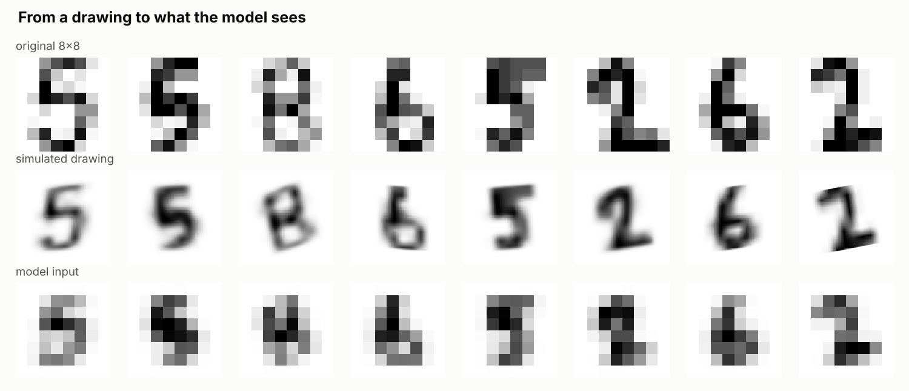
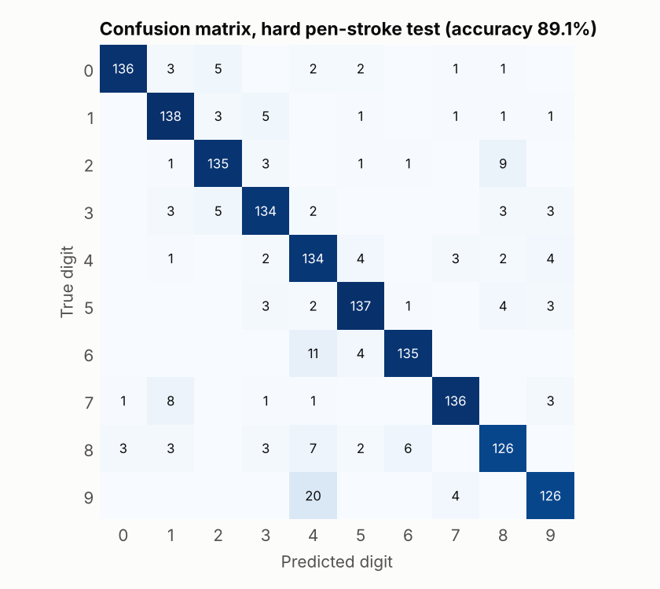

# Handwritten Digit Recognizer (neural network in the browser)

**Live demo: https://race72195-lang.github.io/digit-recognizer/**

Draw a digit with the mouse or a finger, and a small neural network running entirely in your browser guesses it, shows the probability of every digit and displays the 8 x 8 image that the model actually sees.

The project covers the whole path from data to a working product: training and honest evaluation in Python, a preprocessing step that is identical in Python and JavaScript, and a web app that needs no server.

## How it works

1. **Data:** the digits dataset in scikit-learn, 1,797 small 8 x 8 images (no download needed).
2. **Problem:** the scans are tidy, but a person draws in a browser with a thin, shaky line. A model trained only on the scans fails on real drawings.
3. **Training data (two sources):**
   - the scan images, turned into larger drawings and randomly rotated, sheared and blurred (11,496 samples);
   - digits drawn as pen strokes of random thickness, size, rotation and wobble from hand-made outlines of the digits (`strokes.py`, 7,000 samples).
4. **Preprocessing (in `preprocess.py` and in the web app):** find the box around the ink, fit it into the centre 6 x 6 area of the 8 x 8 grid keeping the aspect ratio, average the ink in every cell and scale the darkest cell to 16.
5. **Model:** a neural network with one hidden layer of 64 units (scikit-learn `MLPClassifier`). Its weights are exported to the web page, where the forward pass is written in plain JavaScript.

## A bug found by testing, and how it was fixed

The first version was trained only on distorted scans and scored 97.6% on its own test set. In use, drawing a **1** often returned **3**. Reproducing it with simulated pen strokes confirmed it: the digit 1 was recognised in only **14%** of cases (overall 76%). The cause was a mismatch between training and use: in the scans a "1" is a thick shape, while a line drawn with a mouse is much thinner relative to its height, and the model had never seen such input. The test set came from the same source as the training data, so it could not reveal this.

The fix was to add pen-stroke digits of varied thickness to the training data and to evaluate on a separate, more distorted pen-stroke set. After the fix the digit 1 is recognised in **92%** of cases on that hard set.

## Results

Evaluated on data never used for training:

| Model | Clean scans (360) | Distorted scans (1,440) | Pen strokes (1,500) | Hard pen strokes (1,500) |
|---|---|---|---|---|
| Logistic regression | 91.4% | 91.2% | 99.0% | 84.2% |
| **Neural network (64-64-10)** | **97.8%** | **97.4%** | **99.9%** | **89.1%** |

"Hard pen strokes" use stronger rotation, shear, wobble and a wider range of line thickness than the training data. Accuracy per digit on that set is between 84% (8 and 9) and 92% (1).




## Checks

- The JavaScript preprocessing and prediction match the Python versions (checked against an independent numpy forward pass of the exported weights): identical predictions and differences below 0.00001.
- The page was tested in a headless browser with real mouse strokes: six kinds of "1" (straight, slanted, short, with a flag, with flag and base, off-centre) were all recognised, as were a 3, 7, 0 and 2; no console errors and no horizontal scroll at phone width.

## Limitations

- The pen-stroke tests use digit outlines that I made by hand, so they are not a sample of real human handwriting. Accuracy on real people has not been measured and will be lower than on the simulated strokes.
- The model was trained on small 8 x 8 images, so very unusual styles, several digits at once or tiny drawings can fail. The app says "Not sure" when its confidence is below 50%.
- The simple preprocessing assumes one digit that fills most of the drawing area.

## Run it

Open `docs/index.html` in any browser. To retrain the model and rebuild the page:

```bash
pip install -r requirements.txt
python train.py
```

## Publish it as a link (GitHub Pages)

Repository **Settings -> Pages -> Build and deployment -> Branch: main, folder: /docs -> Save**. After a minute the page is available at `https://<username>.github.io/digit-recognizer/`.

## Project structure

```
train.py            data, augmentation, training, evaluation, export to the web app
strokes.py          simulated pen-stroke digits (training and testing data)
preprocess.py       drawing -> 8 x 8 input (same algorithm as in the web app)
app_template.html   the web app (HTML, CSS, JavaScript); train.py inserts the model into it
docs/index.html     the finished web app (published through GitHub Pages)
results/            metrics
images/             charts
```

---
Alizhan Islam | https://www.linkedin.com/in/alizhan-islam-960790362 | alizhan1809@gmail.com
